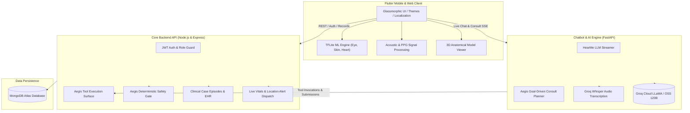

<div align="center">


<p>
  
  
  
  
</p>

<p>
  
  
  
  
  
  
  
  
  
  
</p>

<br/>

> ### Other apps digitize symptom checklists. We built an autonomous clinical guardian.
> A multi-modal, on-device diagnostic powerhouse that screens for metabolic, cardiovascular, and respiratory conditions through non-invasive biomarkers, protected by the deterministic **Aegis Clinical Decision Guard** with real-time doctor telemetry.

</div>

---

## Table of Contents

- [The Healthcare Dilemma](#the-healthcare-dilemma)
- [What We Built](#what-we-built)
- [The Aegis Clinical Decision Engine](#the-aegis-clinical-decision-engine)
- [Multi-Modal Screening Arsenal](#multi-modal-screening-arsenal)
- [MindSpace & Voice Biomarkers](#mindspace--voice-biomarkers)
- [HearMe Context-Aware Medical Copilot](#hearme-context-aware-medical-copilot)
- [Interactive 3D Anatomical Visualizer](#interactive-3d-anatomical-visualizer)
- [Feature Highlights](#feature-highlights)
- [System Architecture](#system-architecture)
- [Tech Stack](#tech-stack)
- [Role-Based Access & Workflows](#role-based-access--workflows)
- [Getting Started](#getting-started)
- [Backend Services Setup](#backend-services-setup)
- [Project Structure](#project-structure)
- [Team Synora](#team-synora)

---

## The Healthcare Dilemma

Modern healthcare diagnostics suffer from three fundamental bottlenecks:

- **Asymptomatic Progression**: Conditions like Type-2 Diabetes, Hypertension, and Anemia develop quietly over years before clinical diagnosis.
- **Fragmented Evidence & Hallucinations**: Standard AI symptom checkers rely on probabilistic LLM responses without grounding in physical biomarkers, deterministic safety guardrails, or cross-modality verification.
- **The Telehealth Disconnect**: Remote patients lack affordable clinical screening tools, while physicians receive noisy, unverified subjective complaints instead of calibrated telemetry.

**MedicoScope Aegis replaces fragmented health checklists with an intelligent diagnostic command center** that combines on-device neural edge computing, digital signal processing (DSP), and the deterministic **Aegis Safety Gate** to deliver hospital-grade screening directly on commodity smartphones.

---

## What We Built

A unified, full-stack medical intelligence platform encompassing the complete patient and clinical lifecycle:

```
Capture Data  ->  Edge Inference  ->  Aegis Fusion  ->  Clinical Action  ->  Telehealth Sync
 Camera, Mic,     On-device TFLite,   Deterministic     SSE Decision         Doctor Alert,
 Vitals, Labs     DSP Signal Filter   Safety Gate       Trace & Triage       GPS & EHR Link
```

- 🩺 **Multi-Modal Screening Suite**: 7 non-invasive screening modalities covering Diabetes, Hypertension, Anemia, and Respiratory ailments.
- 🛡️ **Aegis Clinical Decision Engine**: Autonomous planning loop with deterministic safety gating, contradiction detection, and real-time SSE execution traces.
- 🧠 **MindSpace Acoustic Voice Biomarker**: Calibrated DSP voice check-ins analyzing pitch perturbation (jitter), amplitude perturbation (shimmer), HNR, and formants.
- 💬 **HearMe LLM Copilot**: Low-latency health companion powered by Groq LLaMA / OSS models grounded in the patient's verified EHR records.
- ❤️ **CardioScope Auscultation**: On-device heart sound classification (Normal vs Valvular heart disease) via MFCC feature extraction and TFLite neural nets.
- 🧬 **Interactive 3D Anatomy**: Real-time 3D rendered organ models (Heart, Eye, Pancreas, Skin) demonstrating pathological lesions.
- 🗺️ **Emergency Telehealth & Geo-Routing**: Real-time patient threshold breach alerts with live GPS coordinate dispatch to connected doctors.
- 🏆 **Health Engagement Gamification**: Synora Health Coins ecosystem rewarding preventive health habits and medication adherence.
- 🌐 **Global Accessibility**: Multi-language localization for 7 languages (English, Hindi, Tamil, Telugu, Marathi, Bengali, Kannada) and fluid Glassmorphism UI.

---

## The Aegis Clinical Decision Engine

Aegis is the intelligence layer ensuring all AI decisions are **safe, explainable, and grounded in physical evidence**. The LLM is restricted to planning and synthesis, while medical safety is strictly governed by deterministic rule contracts.

```
                           +------------------------+
                           | Patient Chief Complaint |
                           +-----------+------------+
                                       |
                                       v
                    +--------------------------------------+
                    |  Aegis LLM / Keyword Triage Planner  |
                    +------------------+-------------------+
                                       |
                                       v
                    +--------------------------------------+
                    |     Evidence-Gathering Schedule      |
                    |    (Cheap/Local -> Deep Network)     |
                    +------------------+-------------------+
                                       |
                     +-----------------+-----------------+
                     |                                   |
                     v                                   v
             [ Tool Invocations ]               [ Physical Evidence ]
           Lab, PPG, Pallor, Audio             Vitals & Calibration Data
                     |                                   |
                     +-----------------+-----------------+
                                       |
                                       v
                    +--------------------------------------+
                    |   Cross-Modal Contradiction Check    |
                    |   (Discrepancy -> Trigger Re-Plan)   |
                    +------------------+-------------------+
                                       |
                                       v
                    +--------------------------------------+
                    |        Aegis Deterministic Gate      |
                    |     (Confidence Cap & Proof Hash)    |
                    +------------------+-------------------+
                                       |
                                       v
                    +--------------------------------------+
                    |   SSE Streaming Decision Trace & UI  |
                    +--------------------------------------+
```

### Key Guarantees:
1. **Zero Hallucination Safety**: If biometric data is missing, Aegis explicitly returns `not_assessed` rather than fabricating a "low risk" score.
2. **Cross-Modality Tiebreaking**: When two sensors contradict (e.g. normal symptom score but high PPG blood pressure), Aegis automatically schedules a tiebreaker modality.
3. **Fidelity-Weighted Confidence**: High-fidelity lab reports carry more mathematical weight than self-reported symptoms.
4. **Audit Proof Ledger**: Every consult generates an immutable decision trace linked into a verified ledger on the server.

---

## Multi-Modal Screening Arsenal

MedicoScope unifies 7 complementary screening vectors into standardized, actionable risk scores (**Low / Moderate / High / Critical**):

| Modality | Target Condition | Methodology & Technology | Input Source |
|:---|:---|:---|:---|
| **Lab Report Parser** | Diabetes, Anemia, Renal | Automated regex & OCR extraction of HbA1c, Fasting Glucose, Hemoglobin, RBC, Platelets | PDF Document |
| **Symptom Questionnaire** | Multi-system screening | Clinical Bayesian symptom scoring matrix with acuity triage | Interactive UI |
| **Cuff-Less Blood Pressure** | Hypertension, Hypotension | Butterworth filtered camera PPG, SDPPG pulse contour analysis, systolic/diastolic timing | Smartphone Camera + Flash |
| **Conjunctival Pallor** | Anemia | Eyelid erythema index (EI), RGB/HSV chromaticity ratios, and pallor segmentation | Front/Back Camera |
| **Retinal Fundus Analysis** | Diabetic Retinopathy | Convolutional TFLite neural network detecting microaneurysms and exudates | Fundus Lens Attachment |
| **CardioScope Auscultation** | Valvular Heart Disease, Murmurs | Audio PCM decoding, 13-band MFCC extraction, on-device `heart_model.tflite` | Microphone / Stethoscope |
| **Respiratory Acoustic** | Asthma, COPD, Bronchitis | Envelope STFT analysis, wheeze/crackle transient detection, inhale/exhale ratio | Device Microphone |

---

## MindSpace & Voice Biomarkers

MindSpace evaluates emotional well-being and depressive speech markers through acoustic digital signal processing (DSP):

- **Autocorrelation F0 Pitch Tracking**: Quantifies tonal variation and monotone pitch compression.
- **Jitter & Shimmer Perturbation**: Computes cycle-to-cycle frequency and amplitude instability.
- **Harmonics-to-Noise Ratio (HNR)**: Detects vocal breathiness and asthenia.
- **Personalized Baseline Calibration**: Scans against the patient's individual baseline voice to eliminate demographic acoustic bias.
- **Speech-to-Text Emotion Analysis**: Transcribed via Groq Whisper (`whisper-large-v3-turbo`) with supportive empathetic guidance.

---

## HearMe Context-Aware Medical Copilot

HearMe is a clinical assistant integrated into every screening result:
- **EHR Context Injection**: Chat prompts automatically ingest recent vitals, detected risks, and calibration history.
- **Ultra-Fast Streaming**: Groq Cloud inference delivers instantaneous multi-token generation.
- **Actionable Suggestions**: Recommends appropriate specialists, lifestyle modifications, and dietary guidelines based on screened conditions.

---

## Interactive 3D Anatomical Visualizer

To bridge patient understanding, MedicoScope embeds interactive 3D WebGL / GLB anatomical models:
- **3D Heart**: Inspect coronary arteries, valvular blood flow, and simulate arrhythmias.
- **3D Pancreas & Blood Vessel**: Visualize glucose crystallization and insulin regulation.
- **3D Eye & Retina**: Explore fundus layers, macula edema, and retinal micro-vascular damage.
- **Skin Lesion Explorer**: High-fidelity structural layers of cutaneous pathology.

---

## Feature Highlights

| Feature | Description |
|:---|:---|
| **🎨 Glassmorphism UI** | Liquid-glass cards with backdrop blur, smooth micro-interactions, and dark/light modes |
| **🩺 Aegis Live Consult** | Interactive step-by-step diagnostic agent with dynamic progress logs and visual hash chains |
| **📍 Telehealth & SOS Alerts** | Automatic critical vitals triggers with live GPS map coordinates dispatched to doctors |
| **🤝 Doctor-Patient Linking** | Secure 6-character code link pairing patients directly to their primary physician's portal |
| **📅 Smart Appointments** | Integrated consultation scheduler with real-time status management (Pending, Confirmed, Completed) |
| **🗺️ Nearby Hospital Locator** | Interactive OpenStreetMap radar locating medical centers and specialty clinics |
| **🏆 Synora Health Rewards** | Gamified coin rewards for regular screening, mental health check-ins, and step tracking |
| **🌐 7 Native Languages** | English, Hindi (हिंदी), Tamil (தமிழ்), Telugu (తెలుగు), Marathi (मराठी), Bengali (বাংলা), Kannada (ಕನ್ನಡ) |

---

## System Architecture



---

## Tech Stack

<table>
<tr>
<td valign="top" width="50%">

### Frontend & Edge ML
| Component | Technology |
|:---|:---|
| **Framework** | Flutter 3.6.0 (Dart 3.6.0) |
| **State Management** | Provider Architecture |
| **On-Device Inference** | `tflite_flutter` (Edge Models) |
| **Signal Processing** | `fftea`, custom Butterworth DSP |
| **3D Rendering** | `model_viewer_plus` (Three.js / GLB) |
| **Mapping & GPS** | `flutter_map` (OpenStreetMap) + `geolocator` |
| **Typography & Styling** | Google Fonts (Inter / Outfit) + Flutter Animate |
| **PDF Extraction** | `syncfusion_flutter_pdf` |

</td>
<td valign="top" width="50%">

### Backend & Cloud Services
| Component | Technology |
|:---|:---|
| **Core API Server** | Node.js (v20+) + Express |
| **AI Microservice** | Python 3.11 + FastAPI + Uvicorn |
| **LLM Inference** | Groq Cloud SDK (`openai/gpt-oss-120b`) |
| **Speech-to-Text** | Groq Whisper (`whisper-large-v3-turbo`) |
| **Database** | MongoDB Atlas / Mongoose ORM |
| **Authentication** | JSON Web Tokens (JWT) + bcrypt |
| **Real-time Protocol** | Server-Sent Events (SSE) & WebSockets |
| **Cloud Deployment** | Render Cloud PaaS |

</td>
</tr>
</table>

---

## Role-Based Access & Workflows

MedicoScope provides tailored interfaces for each stakeholder in the care continuum:

| Feature Area | 👤 Patient | 🩺 Doctor | 🛡️ Admin |
|:---|:---:|:---:|:---:|
| Multi-Modal Screenings | ✅ Run Scans & View History | ✅ Review Clinical Telemetry | ❌ |
| Aegis Diagnostic Consult | ✅ Interactive Consult | ✅ View Step Traces & Proofs | ❌ |
| MindSpace & Chatbot | ✅ Full Voice & Chat | ✅ View Sentiment Trends | ❌ |
| Live Vitals Alerts | ✅ Emergency SOS Push | ✅ Receive Real-Time Map Alerts | ❌ |
| Clinical Case Management | ❌ | ✅ Manage Linked Patients & Notes | ❌ |
| Appointment Management | ✅ Book & Cancel | ✅ Confirm & Complete | ✅ Global Audit |
| Gamification & Coins | ✅ Earn & Redeem Rewards | ❌ | ✅ Configure Rewards |
| System Statistics & Logs | ❌ | ❌ | ✅ Full Infrastructure Telemetry |

---

## Getting Started

### Prerequisites
- **Flutter SDK**: 3.6.0 or higher ([Install Guide](https://flutter.dev/docs/get-started/install))
- **Node.js**: 20.x or higher
- **Python**: 3.10 or higher
- **Android SDK & NDK**: Version `28.0.12674087` or `27.0.12077973`

### 1. Clone the Repository
```bash
git clone https://github.com/college-hack24-nov26/hack-team-synora.git
cd hack-team-synora
```

### 2. Configure Client Dependencies
```bash
flutter pub get
```

### 3. Verify ML & 3D Assets
Ensure required models are present in the assets folder:
```
assets/
|-- models/
|   |-- eye_float16.tflite
|   |-- eye_float32.tflite
|   |-- skin_float16.tflite
|   \-- heart_model.tflite
\-- 3d_models/
    |-- heart.glb
    \-- skin.glb
```

### 4. Run the Flutter App
```bash
flutter run
```

---

## Backend Services Setup

### Node.js API Server (`server/`)
1. Navigate to the server folder:
   ```bash
   cd server
   npm install
   ```
2. Create `.env` file:
   ```env
   PORT=5000
   NODE_ENV=development
   MONGODB_URI=mongodb://127.0.0.1:27017/medicoscope
   JWT_SECRET=your_jwt_secret_token
   SERVICE_KEY=your_shared_service_secret
   ```
3. Start the server:
   ```bash
   npm start
   ```

### Python FastAPI Chatbot & Aegis Service (`chatbot/`)
1. Navigate to the chatbot directory:
   ```bash
   cd chatbot
   pip install -r requirements.txt
   ```
2. Create `.env` file:
   ```env
   GROQ_API_KEY=your_groq_api_key
   GROQ_MODEL=openai/gpt-oss-120b
   BACKEND_URL=http://localhost:5000/api
   SERVICE_KEY=your_shared_service_secret
   ```
3. Run the microservice:
   ```bash
   uvicorn main:app --host 0.0.0.0 --port 8000 --reload
   ```

---

## Project Structure

```
hack-team-synora/
|-- android/                    # Android native Gradle configuration & permissions
|-- assets/
|   |-- 3d_models/             # Interactive 3D anatomical models (.glb)
|   |-- icons/                 # High-resolution clinical vectors & iconography
|   |-- images/                # UI illustrations and onboarding assets
|   \-- models/                # Quantized TFLite edge neural network models
|-- chatbot/                   # Python FastAPI AI & Aegis consult service
|   |-- aegis_consult.py       # Aegis planner, contradiction resolver & SSE stream
|   |-- main.py                # HearMe LLM streaming, MindSpace voice transcription
|   \-- requirements.txt       # Python dependencies (FastAPI, Groq, LangChain)
|-- lib/
|   |-- core/                  # Design tokens, AppTheme, localization, constants
|   |-- data/                  # Disease reference datasets & symptom score matrices
|   |-- models/                # Data models (User, Doctor, Patient, DiseaseRiskResult)
|   |-- screens/               # Feature UI screens (Auth, Dashboards, MindSpace, Map)
|   |-- services/              # API clients, Aegis gate, TFLite inference, DSP analyzers
|   \-- main.dart              # Application entrypoint & state providers
|-- server/                    # Node.js Express REST API server
|   |-- src/
|   |   |-- config/            # MongoDB database connection pool
|   |   |-- middleware/        # JWT auth verify, role check, rate limiting
|   |   |-- models/            # Mongoose schemas (User, Episode, Detection, Alert)
|   |   |-- routes/            # REST endpoints (Auth, Doctors, Aegis, Vitals)
|   |   \-- index.js           # Server bootstrap & route registration
|   \-- package.json
\-- README.md                  # Complete project documentation
```

---

## Team Synora & Contributors

Developed with precision and passion for healthcare accessibility by **Team Synora**:

| Contributor | GitHub Profile | Role & Primary Ownership |
| :--- | :--- | :--- |
| **Pratik Sachin Kumbhar** | [@Pratik-1213](https://github.com/Pratik-1213) | **Team Lead & Core Clinical Architecture**<br>Aegis Quality Gate, Deterministic Medical Record Auditing, Certified Report PDF Service, Live Consultation Telemetry |
| **Atharva Awade** | [@atharva-awade](https://github.com/atharva-awade) | **Biomedical DSP & Clinical Copilot**<br>rPPG Contactless Camera Pulse Detection, Calibrated Cuff-less BP, Acoustic Respiratory DSP, MindSpace Voice Biomarkers, Doctor Copilot |
| **Aishwarya Gahukar** | [@AishwaryaGahukar2902](https://github.com/AishwaryaGahukar2902) | **Full-Stack Backend & Patient UX**<br>Node.js Express REST API, JWT Authentication, EHR Database Connectors, Conversational AI Triage Bridge, Patient Health Portal |
| **aj-studios** | [@aj-studios](https://github.com/aj-studios) | **Project Scaffolding & DevOps Infrastructure**<br>Repository Scaffolding, Cross-Platform Deployment Manifests, Baseline CI/CD Configuration |

<div align="center">

<br/>

**Transforming preventive healthcare through autonomous edge intelligence.**


</div>
